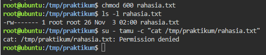
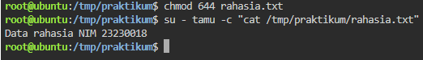
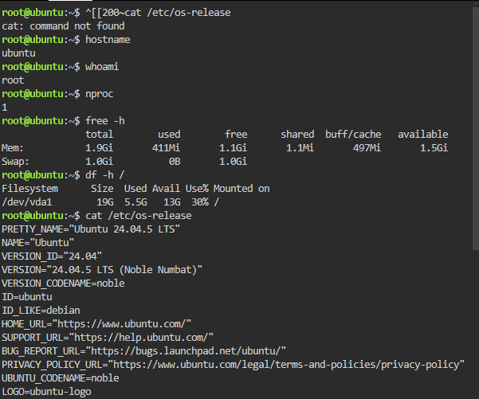
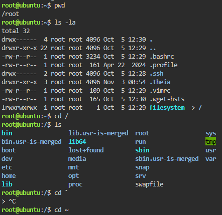
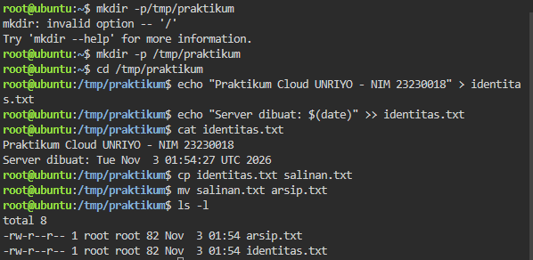
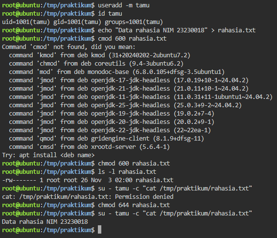

A.  Spesifikasi Server

    Versi OS: 24.04.5 LTS (Noble Numbat)
    Jumlah CPU/RAM/DISK Capacity: 1/1.9Gi/19G

B.  Tangkapan layar (permission denied)
    dengan chmod 600
    

    dengan chmod 644
    

C.  Jawaban pertanyaan nomor 1-4
    1.  Karakteristik NIST yang saya alami diantaranya;
        a.  Resource Pooling: tentunya penyedia cloud 
            memiliki sumber daya fisik yang akan dialokasikan ke banyak pengguna sekaligus. Dapat terlihat bagaimana pengalokasiannya saat menjalankan langkah ke-2
    
        b.  On-Demand Self-Service: dapat terlihat pada 
            saat membuka playground, server ubuntu langsung menyala tanpa pengajuan izin ke admin/yang bersangkutan (instan).

    2.  Jika disamakan dengan layanan seperti IaaS, PaaS 
        atau SaaS, maka lapisan yang saya kelola sendiri adalah lapisan data, konfigurasi, dan aplikasinya.

    3.  Kenapa izinnya ditolak karena bit akses (baca) 
        hanya diberi ke pemilik saja, sedangkan user lain tidak (bernilai nol) = 600. Izin baru bisa diterima setelah diganti ke 644 sehingga file dapat dibaca.

    4.  Yang terjadi pada file bila sesi habis adalah 
        terhapus, karena playground bersifat sementara selama waktunya masih/belum habis. Hal ini penting dipahami agar developer tidak menyimpan data krusial di penyimpanan sementara.

--

screenshot

langka 2

langkah 3

langkah 4

langkah 5
