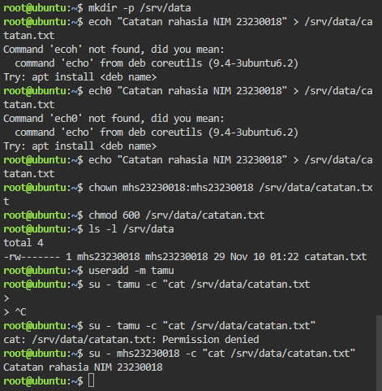
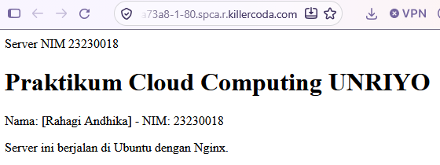
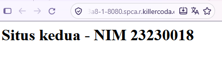
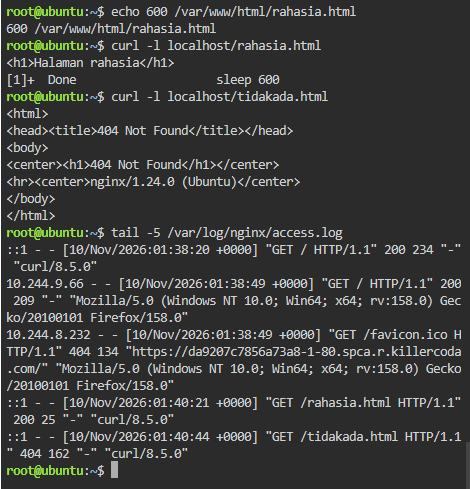

sc langkah 3 (error-permission denied)

gambar permission denied

sc langkah 7 & 10 (port 80 dan port 8080)

gambar page situs A

gambar page situs B

sc langkah 8 (tabel)

gambar kode yang didapat

jawaban pertanyan evaluasi nomor 1-5

1. Admin server sebaiknya bekerja sebagai user biasa untuk mencegah potensi kesalahan ketik/typo. dengan menggunakan sudo diharapkan perintah yang berisiko tidak dapat dijalankan tanpa izin khusus/verifikasi kata sandi.

2. Uji coba permission tidak dapat dilakukan karena user root memiliki akses penuh untuk membaca/mengelola file tanpa izin khusus. 

3. Karena hanya pemilik file yang diberikan ijin hak baca dan tulis sedangkan user www-data tidak memiliki izin untuk membaca file tersebut. 

4. Perbedaannya untuk restart efeknya akan menghentikan semua proses secara total sedangkan reload hanya menerapkan pembaruan konfigurasi baru tanpa menghentikan service Nginx.

5. perintah yang perlu disimpan yaitu 
    a. file konfigurasi situs web
    b. file konten
    c. riwayat perintah bash
    d. instalasi paket.
    c. pengaturan hak akses
    d. pembuatan user, group, dan tautan.